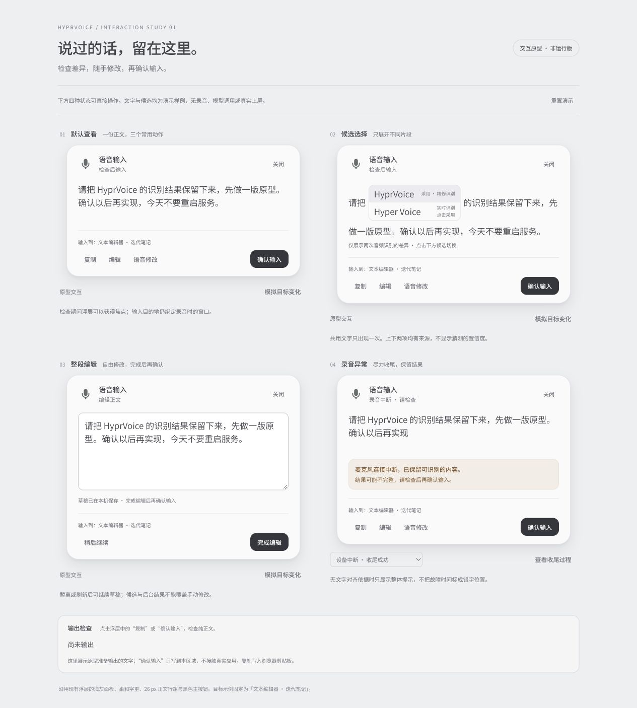

# 结果检查 UI 原型 · 2026-10-17

> **v1未获用户批准，现归档。新版可点击原型、高清近景和检查记录见 [v2/README.md](v2/README.md)。A版已经委托审查确认，生产候选另见结果检查文档。**

v1阶段交付是独立静态交互原型；该阶段未实施生产 UI 和异常恢复。所有正文、ASR 候选、目标窗口和故障场景都是明确标注的演示数据；没有录音、模型请求或真实窗口输入。F9 按钮只展示接口说明，不冒充语音修改已经接通。

预览：`python3 -m http.server 8768 --bind 127.0.0.1 --directory docs/result-review-prototype`。访问 <http://127.0.0.1:8768/>。四种状态并排，可切换候选、整段编辑、暂存/继续草稿、保存后确认、复制和查看异常收尾。草稿及演示状态保存在该浏览器 origin 的 localStorage；重置演示会清除。复制使用真实浏览器剪贴板，输入只进入页面底部的输出检查区。

## 当前证据与边界

- 共享 checkout 开始时为干净 `main=a5d44d1`。从本地已有 `origin/codex/cornice-seat-input=25a058f` 建立 `codex/result-review-prototype` 和独立 worktree `.worktrees/result-review-prototype`；没有切换共享 checkout。
- 基线保留完整四个 main 之外的提交：`7e82cc0` controlled seat、`4cb409a` physical input capability、`52f5ec4` native local editors、`25a058f` generic local overlays。没有 fetch、merge、push、安装或重启。
- 运行进程 PID 1473702，`/home/liufeng/.local/bin/hyprvoice serve`，版本输出 `0.2.1`。安装文件和 `/proc/1473702/exe` 的 SHA-256 一致：`7def571c580268c2866fdffdf12815ade78762450342945088ea6c3da6353d76`。运行服务 active。
- **运行文件的精确源码提交未核实。** 它有 `Desktop::rebind` 与 `seatinputfocus` 标记，但未找到最后一提交的 `register-local-overlay` 字符串和 overlay 方法。不能把“版本号相同”当作运行版包含完整四提交的证据。后续安装前仍须追溯构建记录；本轮完全保留运行文件。
- 已读取当前 `src/app.cpp`、`src/app.h`、`src/asr.cpp`、`src/asr.h`、`src/audio.cpp`、`src/transcript_text.cpp`、`src/overlay_style.h`，以及结果动作、UI 与行距记录。main 线索成立：错误 catch 调 stop/cancel 并清空 text；正文是 GTK Label；正常结束已有 stop→take→finish；离线精修失败保留 streaming。`HasIsolatedLatinChange` 只处理特定中英差异，不是通用否定词检测。
- 当前 `Transcript` 没有独立的 refined 字段，也未公开词级对齐结果；不能凭已有 text/raw 状态直接生成可靠的双来源候选或错误位置。

## 已与 F9 线程确认的接口

并行线程 `01a14a4f-d0a9-70d2-ab4e-ca8679b34761` 使用 `.worktrees/current-result-voice-edit` / `codex/current-result-voice-edit`，同样基于 `25a058f`。它负责生产结果/语音修改逻辑和测试；本线程此轮只拥有 `docs/result-review-prototype/**`，不修改 src 或构建配置。

| 接口 | 约定 |
| --- | --- |
| `raw` | 不可变的本轮采用 ASR 正文；不是 LLM 改写前后双候选接口 |
| `text` | 现有处理版本；保留兼容，避免两线程分别重定义 |
| `effective_text` | 唯一当前有效正文，包含当前候选选择或已保存手动编辑；复制、输入、F9 读取同一值 |
| `session_id` / `result_revision` | 每次保存、候选切换、语音修改、撤销使结果版本递增；异步回包校验会话和基线版本 |
| `revision_instruction` | 口述要求独立保存，永远不作为待输入正文 |
| `edit-result` | 提交 `session_id`、`base_revision`、`text`；拒绝旧版本覆盖 |
| `revise` / `command` | 同义入口，修改当前结果；不依赖目标应用选区 |
| `undo-revision` | 恢复该次语音修改开始前的有效正文，保留此前手动修改/候选选择 |
| `discard` | 放弃整轮；与取消一次语音修改分开 |

待生产 UI 接入时，编辑草稿独立于 `effective_text` 保存；编辑中禁用候选与 F9，完成后先保存再返回检查。存在暂存草稿时 F9 要求先完成；后台回包不得更新草稿。手动或模型产生整段新版后，旧 ASR 候选停止作为当前正文上的可点击替换，避免静默撤销用户改动。

`target_` 和原始输入保护信息绑定同一轮初始目标；浮层获焦不是新目标授权。保留 Cornice overlay/seat 路由；目标变化时保留正文并拦截确认输入，恢复目标后仍需执行真实生产检查。原型中的目标变化仅是显式演示开关。

## 确认后的实现约束

1. 分开处理主动取消与采集故障。故障停止采集后先取尽仍有效队列，复用当前 ASR finish 和离线失败回退；finish 本身失败再采用最后非空预览。积压已经丢弃的音频不能宣称恢复。无预览后端要尝试已有有效音频，最终没有文字时明确告知，不能虚构结果。
2. 恢复结果持续带 `incomplete/recovered` 状态，禁止自动输入。用户确认、候选切换、保存编辑或 F9 都不能隐式清除此状态。
3. 分别保存真实 streaming/refined 假设和来源；仅在均取得有效结果时做通用文本差异对齐，不依赖英文警告函数。相同部分只出现一次，差异片段当前版本在上、备选在下。LLM 改写比较单独处理，不冒充 ASR 歧义，不添加臆测置信度。
4. 当前缺少公开对齐证据，第一版只用整体/尾部异常提示。未来若加内联标记，必须保存可靠音频时间与文字对齐依据，不能把故障时间当作错字位置。所有提示、来源和候选控件不进入 `effective_text`。
5. 原生编辑需有受控键盘焦点；保留原目标与 Cornice 路由，不能简单将 layer-shell keyboard mode 全局放开后重新抓取 focused window 作为输出目标。

## 本轮验证与下一阶段

已在浏览器实际操作：四状态渲染、候选切换后输出、整段编辑暂离/刷新恢复/完成、完成后返回检查、目标变化禁输入而保留复制、收尾演示保持文字、收尾失败回退、无预览无结果时禁用输出。确认输出区只含选定/编辑后的正文，不带候选来源和异常提示；控制台 error 列表为空。

浏览器复制 writeText 返回成功并显示成功反馈，但工具侧 clipboard.readText 返回空值，未据此宣称系统剪贴板端到端验证通过；页面输出纯正文已核对。真实复制/输入、GTK 焦点、采集中断、积压与真实 ASR finish 都留待用户确认后的原生针对性验收。

下一阶段至少覆盖设备中断、10秒积压边界、有效队列耗尽、finish 抛错、精修失败回退、无预览后端成功/失败、主动取消不恢复、旧异步回包、候选切换、草稿保护、复制/输入纯正文及多桌面目标保护。不得用本页面的演示状态代替生产验证。
